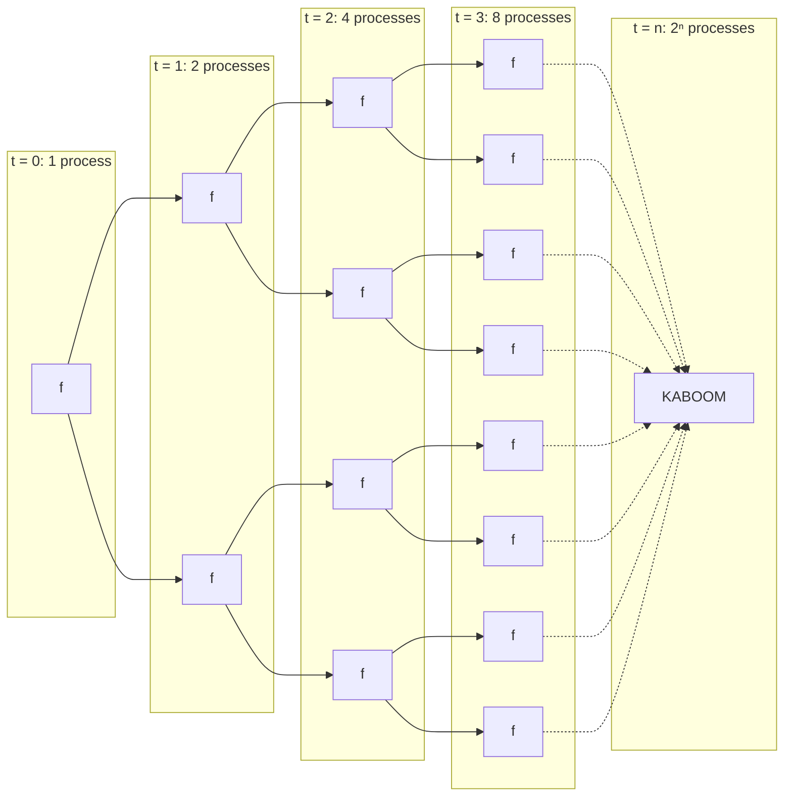

## Intro

For those of you who use bash shells, please believe me when I say that you <u>**should NOT**</u> run this:

```bash
:(){:|:&};:
```

What on earth is going on? Let's figure it out together! 

## What is this command doing?

This command, very confusingly creates a function named `:`. I will re-write this with a function named `f` and some clear formatting:

```bash
f(){
    f | f &
};

f # this is function call
```

Clearly, this function is recursive. In fact, it is doubly recursive ($2^n$ function calls at depth $n$)


Every call to `f` immediately spawns two more copies of itself (one on each side of the pipe) in the background, so the number of running processes doubles at each step:




dang